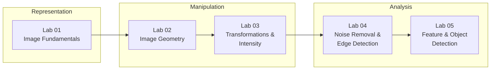
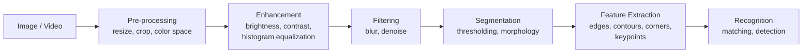
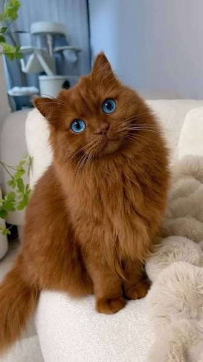
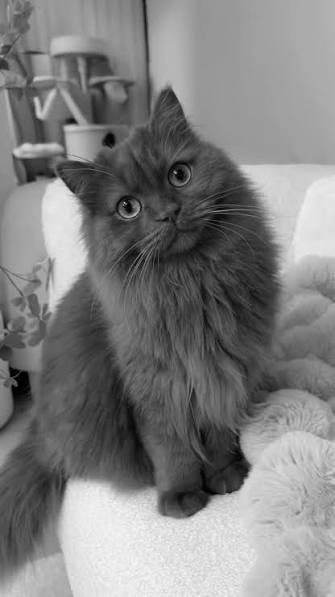
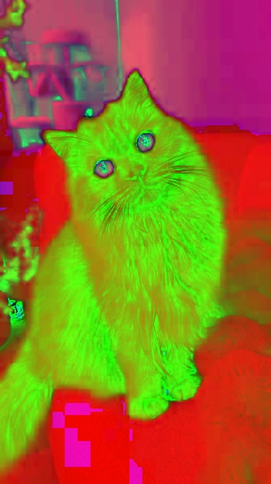
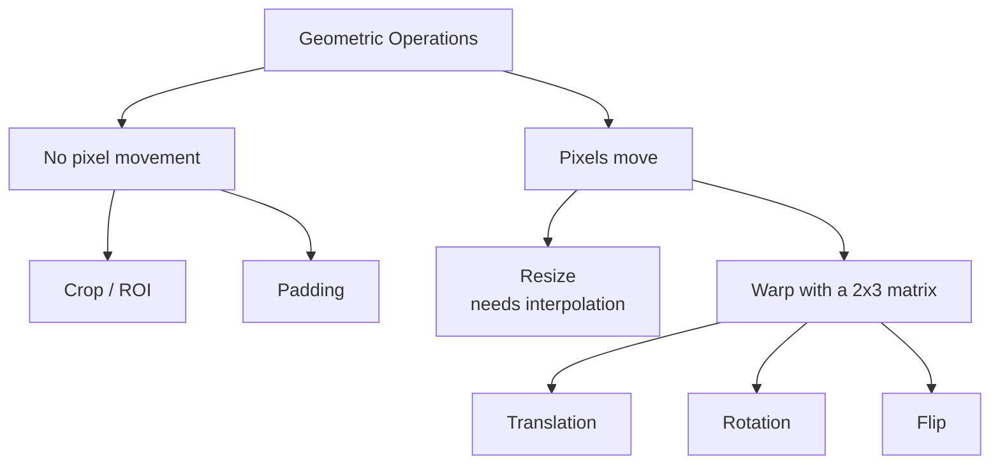
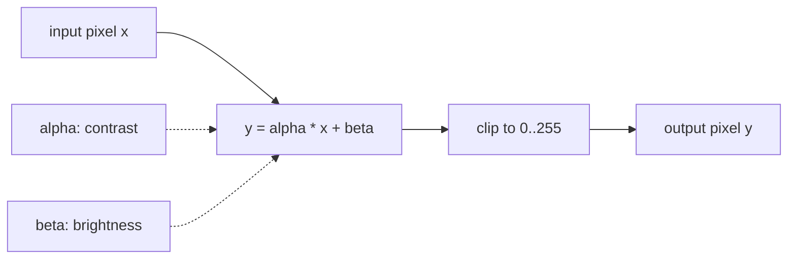
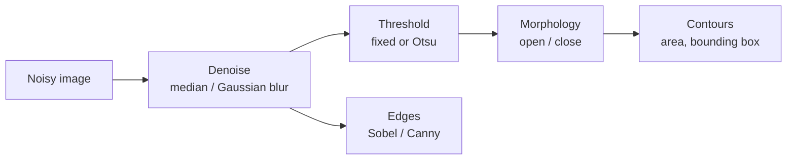
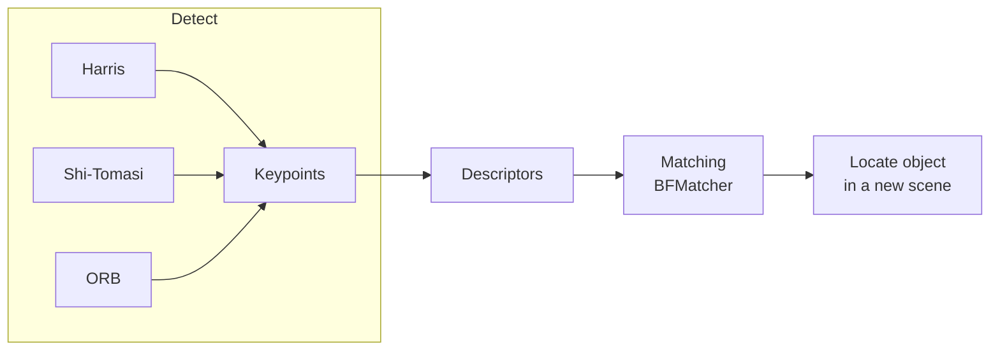

# Computer Vision & Robotics Course

Hands-on lab material for the **Computer Vision** course at the Faculty of Artificial Intelligence & Robotics.

The labs build classical computer vision step by step with **Python, OpenCV and NumPy**. It starts from what a pixel is and goes up to feature detection and object detection. Every lab is a Jupyter notebook. Each topic follows the same order: the problem, why it matters, a visual intuition, the math, the code, and what happened.

Instructor: **Hagar Ghazi**

---

## Contents

- [Course Roadmap](#course-roadmap)
- [Repository Structure](#repository-structure)
- [Labs](#labs)
  - [Lab 01 - Image Fundamentals](#lab-01---image-fundamentals)
  - [Lab 02 - Image Geometry and Manipulation](#lab-02---image-geometry-and-manipulation)
  - [Lab 03 - Transformations, Arithmetic and Histograms](#lab-03---transformations-arithmetic-and-histograms)
  - [Lab 04 - Noise Removal and Edge Detection](#lab-04---noise-removal-and-edge-detection)
  - [Lab 05 - Feature and Object Detection](#lab-05---feature-and-object-detection)
- [Assessments](#assessments)
- [Getting Started](#getting-started)
- [Running on Google Colab](#running-on-google-colab)
- [Prerequisites](#prerequisites)

---

## Course Roadmap

Each lab builds on the previous one. The course moves from how an image is stored, to how it is changed, to how a machine finds structure in it.



The labs cover the full classical vision pipeline:



| Stage | Covered in |
|---|---|
| Image representation, color spaces | Lab 01 |
| Geometry: resize, crop, pad, flip, translate, rotate | Lab 02 |
| Affine transforms, arithmetic, masking, histograms | Lab 03 |
| Filtering, thresholding, edges, morphology, contours | Lab 04 |
| Corners, keypoints, matching, template / motion / face detection | Lab 05 |

---

## Repository Structure

```
.
├── labs/
│   ├── 01-image-fundamentals/
│   │   ├── Lab01_Reading_and_Displaying_Images.ipynb
│   │   ├── cat.jpg
│   │   ├── interactive/            # browser demos (open the .html files directly)
│   │   └── outputs/                # images saved by the notebook
│   ├── 02-image-geometry/
│   │   └── Lab02_Image_Geometry_and_Manipulation.ipynb
│   ├── 03-transformations-and-intensity/
│   │   └── Lab03_Transformations_Arithmetic_and_Histograms.ipynb
│   ├── 04-noise-removal-and-edge-detection/
│   │   └── Lab04_Noise_Removal_and_Edge_Detection.ipynb
│   └── 05-feature-and-object-detection/
│       ├── Lab05_Feature_and_Object_Detection.ipynb
│       └── data/                   # images and video used in the lab
├── assessments/                    # lab quizzes (five equivalent group versions)
├── requirements.txt
└── README.md
```

---

## Labs

### Lab 01 - Image Fundamentals

**Folder:** [`labs/01-image-fundamentals`](labs/01-image-fundamentals)

What a digital image really is: a grid of numbers. Students create images from scratch with NumPy, load real images with OpenCV, and look at the same picture in different color spaces.

**Topics**
- Images as NumPy arrays: shape `(H, W, C)` and the `uint8` data type
- Creating black, white, solid-color and shape images from scratch
- Reading images with OpenCV and displaying them with Matplotlib
- Grayscale, RGBA, HSV and LAB color spaces
- Reading single pixel values
- The BGR vs RGB channel order (channel-swapping experiment)
- Splitting and merging color channels
- Saving images to disk

**Interactive demos** (open in any browser, no installation needed)

| Demo | What it shows |
|---|---|
| [`01_pixel_explorer.html`](labs/01-image-fundamentals/interactive/01_pixel_explorer.html) | An image as a grid of pixel values |
| [`02_pixel_grid_and_coordinates.html`](labs/01-image-fundamentals/interactive/02_pixel_grid_and_coordinates.html) | The pixel grid and the `(row, col)` coordinate system |
| [`03_pixel_zoom.html`](labs/01-image-fundamentals/interactive/03_pixel_zoom.html) | Zoom in until the individual pixels show |
| [`04_rgb_vs_bgr.html`](labs/01-image-fundamentals/interactive/04_rgb_vs_bgr.html) | RGB, grayscale and BGR, and why the channel order matters in OpenCV |
| [`05_resolution.html`](labs/01-image-fundamentals/interactive/05_resolution.html) | How resolution affects detail |

To view a demo, download the file and open it in a browser. GitHub shows HTML files as source code.

**Sample output**: the same image saved in three representations

| Color (BGR) | Grayscale | HSV |
|:---:|:---:|:---:|
|  |  |  |

---

### Lab 02 - Image Geometry and Manipulation

**Folder:** [`labs/02-image-geometry`](labs/02-image-geometry)

Changing the size, shape and position of an image without breaking it. Each part includes interactive widgets so students can change parameters and see the result immediately.

| Part | Topic | Key functions |
|---|---|---|
| 1 | Image geometry and properties, memory size | `img.shape`, `img.dtype`, `img.nbytes` |
| 2 | Aspect ratio and distortion | ratio-preserving resize |
| 3 | Resizing, interpolation and aliasing | `cv2.resize`, `INTER_NEAREST / LINEAR / CUBIC / AREA` |
| 4 | Cropping and Region of Interest (ROI) | NumPy slicing |
| 5 | ROI as a view vs a copy | `.copy()` |
| 6 | Padding, borders and letterboxing | `cv2.copyMakeBorder` |
| 7 | Flipping and data augmentation | `cv2.flip` |
| 8 | Translation | `cv2.warpAffine` |
| 9 | Rotation by 90-degree steps and by arbitrary angles | `cv2.rotate`, `cv2.warpAffine` |

How the transformations relate:



---

### Lab 03 - Transformations, Arithmetic and Histograms

**Folder:** [`labs/03-transformations-and-intensity`](labs/03-transformations-and-intensity)

Continues from Lab 02 (the parts are numbered 10 to 19). It moves from changing **where** pixels are to changing **what values** they hold.

| Part | Topic | Key functions |
|---|---|---|
| 10 | Scaling | `cv2.resize` with `fx`, `fy` |
| 11 | Affine transformation | `cv2.getAffineTransform`, `cv2.warpAffine` |
| 12 | Image arithmetic: NumPy vs OpenCV (wrap-around vs saturation) | `cv2.add`, `cv2.subtract`, `cv2.addWeighted` |
| 13 | Bitwise operations | `cv2.bitwise_and / or / xor / not` |
| 14 | Image masking | masks with `bitwise_and` |
| 15 | Brightness and clipping | `np.clip`, wider data types |
| 16 | Contrast | `cv2.convertScaleAbs` |
| 17 | Image histograms (grayscale and color) | `cv2.calcHist` |
| 18 | Histogram equalization (grayscale and color) | `cv2.equalizeHist` |
| 19 | Normalization vs equalization | `cv2.normalize` |

Brightness and contrast as one linear operation, applied to every pixel:



---

### Lab 04 - Noise Removal and Edge Detection

**Folder:** [`labs/04-noise-removal-and-edge-detection`](labs/04-noise-removal-and-edge-detection)

The core of traditional image processing, finishing with a comparison against deep learning. The lab also shows the failure cases, so students learn where each method stops working.

| Part | Topic |
|---|---|
| 1 | Introduction to image processing |
| 2 | Image enhancement and histograms |
| 3 | Blurring, filtering and noise reduction (salt-and-pepper noise, mean / Gaussian / median blur) |
| 4 | Thresholding and binary images, Otsu's method, adaptive thresholding for uneven lighting |
| 5 | Edge detection: Sobel and Canny, choosing Canny thresholds |
| 6 | Morphological operations: erosion, dilation, opening, closing, cleaning a noisy mask |
| 7 | Contours and traditional computer vision |
| 8 | Traditional computer vision vs deep learning: what a CNN learns, classification / detection / segmentation |

From a raw image to measurable objects:



---

### Lab 05 - Feature and Object Detection

**Folder:** [`labs/05-feature-and-object-detection`](labs/05-feature-and-object-detection)

Finding meaningful points in an image and using them to locate objects. Some cells open a live OpenCV window (video, webcam, mouse and trackbar demos), so this lab should be **run locally**, not on Colab. Press `q` or `Esc` to close the window.

**Part 1 - Quick recap**
Reading and saving video, mouse events, trackbars, measuring performance, HSV color tracking, thresholding (global vs Otsu), filtering, contours.

**Part 2 - Feature detection**

| Method | Output | Function |
|---|---|---|
| Harris corner detector | corner response map | `cv.cornerHarris` |
| Shi-Tomasi | best N corners | `cv.goodFeaturesToTrack` |
| ORB | keypoints and binary descriptors | `cv.ORB_create` |
| Feature matching | matched point pairs between two images | `cv.BFMatcher` |

**Part 3 - Object detection**

| Method | Idea | Function |
|---|---|---|
| Template matching | slide a small image over a large one and score every position | `cv.matchTemplate` |
| Motion detection | difference between consecutive video frames | `cv.absdiff` |
| Haar cascades | pre-trained face and eye detectors | `cv.CascadeClassifier` |



**Data** (in [`data/`](labs/05-feature-and-object-detection/data)): `vtest.avi`, `messi5.jpg`, `box.png`, `box_in_scene.png` and `chessboard.png` are the standard [OpenCV sample files](https://github.com/opencv/opencv/tree/4.x/samples/data). `messi_face.jpg` is a crop of `messi5.jpg`, used as the template.

---

## Assessments

Practical lab quizzes, each written in **five equivalent group versions** with the same difficulty, so neighbouring students get different questions.

| File | Scope | Format |
|---|---|---|
| [`Assessment_01_Labs_1-2_Fundamentals_and_Geometry.pdf`](assessments/Assessment_01_Labs_1-2_Fundamentals_and_Geometry.pdf) | Lab 01 and Lab 02 | 40 min, 20 marks (14 MCQ, 6 written) |
| [`Assessment_02_Lab_2_Image_Geometry.pdf`](assessments/Assessment_02_Lab_2_Image_Geometry.pdf) | Lab 02, parts 1 to 9 | 40 min, 20 marks (14 MCQ, 6 written) |

---

## Getting Started

**1. Clone the repository**

```bash
git clone https://github.com/Hagar-Ghazi/Computer-Vision-and-Robotics-Course.git
cd Computer-Vision-and-Robotics-Course
```

**2. Create a virtual environment and install the requirements**

```bash
python -m venv venv
venv\Scripts\activate          # Windows
source venv/bin/activate       # macOS / Linux
pip install -r requirements.txt
```

**3. Start Jupyter and open a lab**

```bash
jupyter notebook
```

Run the notebook from inside its own lab folder, so relative paths such as `cat.jpg` and `data/` resolve correctly.

---

## Running on Google Colab

Labs 02 and 03 use `ipywidgets` sliders and were built for Google Colab. Labs 01 and 04 also run there. Lab 05 needs a local machine because it opens OpenCV windows.

| Lab | Open in Colab |
|---|---|
| Lab 01 | [Open](https://colab.research.google.com/github/Hagar-Ghazi/Computer-Vision-and-Robotics-Course/blob/main/labs/01-image-fundamentals/Lab01_Reading_and_Displaying_Images.ipynb) (upload `cat.jpg` to the session first) |
| Lab 02 | [Open](https://colab.research.google.com/github/Hagar-Ghazi/Computer-Vision-and-Robotics-Course/blob/main/labs/02-image-geometry/Lab02_Image_Geometry_and_Manipulation.ipynb) |
| Lab 03 | [Open](https://colab.research.google.com/github/Hagar-Ghazi/Computer-Vision-and-Robotics-Course/blob/main/labs/03-transformations-and-intensity/Lab03_Transformations_Arithmetic_and_Histograms.ipynb) |
| Lab 04 | [Open](https://colab.research.google.com/github/Hagar-Ghazi/Computer-Vision-and-Robotics-Course/blob/main/labs/04-noise-removal-and-edge-detection/Lab04_Noise_Removal_and_Edge_Detection.ipynb) |

---

## Prerequisites

- Basic Python: variables, loops, functions, lists
- Basic NumPy: arrays, indexing and slicing
- No prior computer vision knowledge is needed

**Libraries:** `opencv-python`, `numpy`, `matplotlib`, `pillow`, `ipywidgets`, `jupyter`
